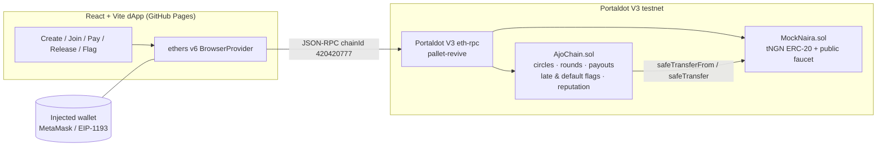
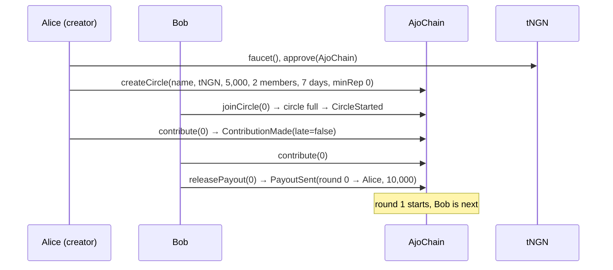

# AjoChain ⭕

**Rotating savings circles (ajo · esusu · adashi) with on-chain records and a portable savings reputation, on Portaldot V3 EVM.**

[](https://github.com/Ridwanlawala/ajochain/actions/workflows/ci.yml)
Live dApp: **https://ridwanlawala.github.io/ajochain/** · Track: **Ecosystem DApps** · Portaldot Hacker House 2026 · Licence: MIT

AjoChain moves the West African rotating savings circle onto Portaldot. A group agrees a fixed contribution and a round length. Every round each member pays in, and the whole pot goes to one member, rotating until everyone has been paid once. The contract holds the money between contribution and payout, records every payment as on time or late, lets anyone flag a member who missed the deadline, and keeps a reputation score that follows each address from circle to circle.

## The problem

Tens of millions of people in Nigeria, Ghana and across the diaspora save through ajo/esusu groups: market traders, artisans, office colleagues, church groups. The model works because of trust in one person, the collector (*alajo*), and that is also where it fails:

- **Collector risk.** The collector holds everyone's cash. Collectors who disappear with a group's money are a recurring story in Nigerian news.
- **No record.** Who paid, who paid late and who has already collected sits in a notebook or a WhatsApp chat. Disputes are one person's word against another's.
- **No portable credit.** Someone who has paid on time in ten circles has nothing to show for it when joining an eleventh group of strangers, or when applying for credit.

## What AjoChain does

| Need | On-chain mechanism |
|---|---|
| Nobody should hold the pot | Contributions go to the `AjoChain` contract. `releasePayout` can be called by **anyone** once every member has paid, and always pays the member whose turn it is. |
| Transparent rotation | Payout order = join order, fixed when the circle fills. `currentRecipient()` and `roundDeadline()` are public. |
| Discipline | Paying after `roundStart + roundDuration` is accepted but recorded as late (`LateFlagged`). After the deadline anyone can `flagDefault` an unpaid member, once per round. |
| Trust between strangers | `reputationScore(address)`: +10 per on-time payment, −5 per late payment, −30 per flagged default, +25 per completed circle. A circle can require a minimum score to join. |
| Try it without money | `MockNaira` (tNGN, 6 decimals) is a valueless test stablecoin with a public `faucet()` (100,000 tNGN per hour per address). |

## Why Portaldot

- **EVM on Portaldot V3.** V3.0 adds Solidity execution through `pallet-revive` alongside ink!/WASM, so a savings product can use audited ERC-20 tooling (OpenZeppelin, ethers, MetaMask) while living on Portaldot.
- **Native assets next.** Portaldot's `assets` pallet can issue a regulated stable asset; the contract takes any ERC-20 address, so a native-asset precompile or wrapper can replace the test token without changing circle logic.
- **DaaS fit.** Portaldot's Default-as-a-Service vision needs reliable default signals. AjoChain's late / default events and reputation are exactly that kind of signal for informal-finance users, who are invisible to credit bureaus.
- **Low, predictable fees** matter when contributions are small and frequent.

## Architecture





| File | Role |
|---|---|
| `contracts/AjoChain.sol` | Circles, rounds, contributions, payouts, late/default flags, reputation |
| `contracts/MockNaira.sol` | tNGN test stablecoin with rate-limited public faucet |
| `test/AjoChain.test.js` | 15 Hardhat tests |
| `scripts/check.js` | Read-only preflight: RPC, chain id, deployer balance |
| `scripts/deploy.js` | Deploys both contracts, writes `deployments/<network>.json` and the frontend config |
| `scripts/demo.js` | Real interactions: faucet → approve → create → join → contribute ×2 → payout, tx hashes saved |
| `frontend/` | React/Vite dApp (injected wallet, add/switch to Portaldot, all circle actions) |
| `PORTALDOT_NOTES.md` | Network research: RPC, chain id, token, account mapping, status log |

### Contract API

```solidity
createCircle(string name, address token, uint256 contribution, uint32 maxMembers, uint64 roundDuration, int32 minReputation) returns (uint256 id)
joinCircle(uint256 id)                  // auto-starts round 0 when the last seat fills
contribute(uint256 id)                  // needs ERC-20 approve; late if after the round deadline
releasePayout(uint256 id)               // anyone; requires all members paid this round
flagDefault(uint256 id, address member) // anyone; after the deadline, once per member per round
getCircle(id) · getMembers(id) · currentRecipient(id) · roundDeadline(id) · reputationScore(addr) · reputationOf(addr)
```

## Portaldot testnet deployment

Network (official PortaldotV3 Testnet guide): RPC `https://test-evm-rpc-v3.portaldot.dev`, chain id `420420777`, gas token `tPOTv3`. There is no EVM block explorer yet; the Substrate node console is `https://node-console.portaldot.dev/`.

| Item | Value |
|---|---|
| AjoChain | _pending: testnet RPC unreachable on 2026-10-16 (see below)_ |
| MockNaira (tNGN) | _pending_ |
| Deployment tx hashes | _pending_ |
| Demo interaction tx hashes | _pending_ (`npm run demo:portaldot` writes them to `deployments/portaldot.json`) |
| Deployer (H160) | `0xfBD8662143AB5De7202799Cb230d591ceE3d933e` |

**Status 2026-10-22:** the testnet moved to `portaldot.dev` on 2026-10-16 (the old `feso-apps.xyz` hostnames are retired) and is live again at chain id `420420777`. Test tokens are distributed to hackathon participants' registered native POT addresses; once tPOTv3 reaches the deployer's mapped SS58 address, the scripts deploy as-is and the table above gets the contract addresses and tx hashes. The full flow was rehearsed on a local Hardhat node. Details in [`PORTALDOT_NOTES.md`](PORTALDOT_NOTES.md).

## Run it

Requirements: Node.js 20+.

```bash
git clone https://github.com/Ridwanlawala/ajochain.git
cd ajochain
npm install
npx hardhat test                 # 15 passing
```

### Deploy to Portaldot V3 testnet

1. Put a **testnet-only** private key in `.secrets/deployer.key` (gitignored) or export `PORTALDOT_PRIVATE_KEY`. For the demo script, also put a second key in `.secrets/member2.key`.
2. Fund it: in the node console go to *Developer → Runtime calls → reviveApi → accountId*, enter your H160 address, and send tPOTv3 to the SS58 address it returns.
3. Run:

```bash
npm run check:portaldot    # chain id, block, balance
npm run deploy:portaldot   # writes deployments/portaldot.json + frontend/src/deployments.json
npm run demo:portaldot     # real create → join → contribute → payout, tx hashes saved
```

Override the RPC with `PORTALDOT_RPC=<url>` if Portaldot announces a new endpoint.

### Rehearse locally

```bash
npx hardhat node                                   # terminal 1
npx hardhat run scripts/deploy.js --network localhost
npx hardhat run scripts/demo.js --network localhost
```

(The local deployer needs a balance: use `hardhat_setBalance` or a funded Hardhat account key.)

### Frontend

```bash
cd frontend
npm install
npm run dev        # http://localhost:5173/ajochain/
npm run build      # static build in frontend/dist (deployed to GitHub Pages)
```

The dApp reads contract addresses from `frontend/src/deployments.json`; you can also paste addresses in the UI (stored in localStorage). Connect MetaMask, click *Switch to Portaldot* (adds the network if missing), claim tNGN from the faucet, then create or join a circle.

## Roadmap

- Deploy and record real interactions on the Portaldot V3 testnet (blocked on RPC/funding, see above).
- Swap tNGN for a Portaldot `assets`-pallet stable asset via precompile/wrapper.
- Optional collateral or insurance pool for defaulted rounds; feed default events to DaaS-style recovery.
- Bid-based payout order (members bid a discount for an earlier turn), a common ajo variant.
- Mobile-first PWA and USSD/WhatsApp notifications for round deadlines.

## Disclosed dependencies

| Dependency | Use | Licence |
|---|---|---|
| [OpenZeppelin Contracts 5](https://github.com/OpenZeppelin/openzeppelin-contracts) | ERC20, SafeERC20, ReentrancyGuard | MIT |
| [Hardhat](https://hardhat.org) + hardhat-toolbox (ethers, chai, mocha, network-helpers) | Compile, test, deploy | MIT |
| [ethers v6](https://github.com/ethers-io/ethers.js) | Wallet + contract calls in the dApp | MIT |
| [React 18](https://react.dev) + [Vite 5](https://vitejs.dev) | Frontend | MIT |
| Portaldot V3 testnet guide (ItsCogumellum/portaldot-v3-testnet-guide) | Network parameters | — |

No code was copied from other projects. AI assistance was used for parts of implementation and documentation; design, testing and submission are by the author.

## Author

Lawal Ridwan · GitHub [@Ridwanlawala](https://github.com/Ridwanlawala) · built during Portaldot Hacker House 2026 (Oct 14 – Nov 6, 2026).
